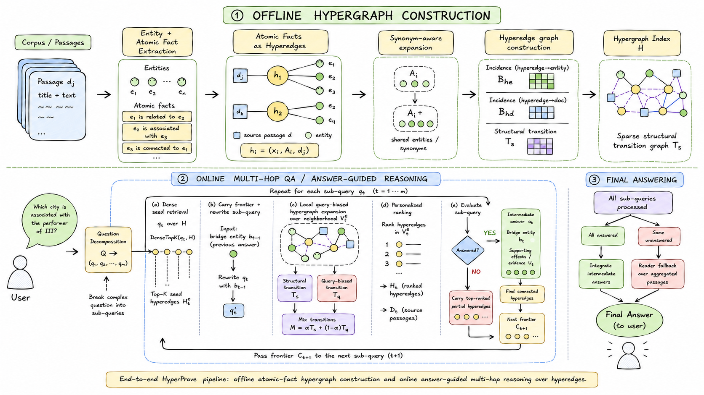

# HyperProve: Answer-Guided Hypergraph Expansion for Multi-Hop Question Answering

> A retrieval-augmented QA framework that makes the reasoning state **structural**: intermediate answers and their supporting atomic facts are carried forward as a hyperedge frontier that biases the next hop of retrieval.

## Summary

Multi-hop question answering often fails when retrieval treats evidence as isolated matches to the original question. The facts needed to answer a complex question are usually connected through intermediate entities, relations, and bridge conditions — so the next useful fact may not resemble the question at all. It only becomes relevant *after* an earlier fact has established the right bridge.

Prior work attacks this from two sides, and each leaves a concrete gap:

- **Graph / structured RAG** connects evidence, but ranks a mostly fixed index that is not conditioned on intermediate answers. Passage-level nodes mix several facts and distractors; binary triples go too far the other way, splitting one fact into disconnected pairwise edges and dropping qualifiers, provenance, and multi-entity context.
- **Iterative retrieval** adapts the query across hops, but the state passed between hops is purely *textual* — an intermediate answer is pasted into the next query. Nothing forces the retriever to continue from the evidence unit that supported that answer, so the next hop can restart from surface similarity and follow a plausible distractor.

**HyperProve** couples question decomposition with answer-conditioned expansion over a hypergraph of atomic facts. It does not use atomic facts, hypergraphs, or iterative retrieval in isolation; instead it carries intermediate answers *and* their supporting hyperedges as retrieval state, then uses that state to bias the next local hypergraph expansion. This makes the retrieval process stateful and fact-centered, and lets HyperProve build coherent evidence chains for final answer generation.

## Overall Pipeline



1. **Offline hypergraph construction** — extract entities and atomic facts from each passage, represent every atomic fact as a hyperedge linking all its participating entities and its source passage, merge entity surface forms with a synonym map, and build a sparse structural transition matrix over hyperedges.
2. **Online answer-guided reasoning** — decompose the question into dependent sub-queries. Each hop seeds retrieval from both the carried frontier (hyperedges supporting the previous answer) and fresh dense hits for the rewritten sub-query, expands a local hypergraph neighborhood biased toward the current sub-query, ranks hyperedges, and passes the resolved bridge entity plus its supporting hyperedges forward as the next frontier.
3. **Final answering** — integrate the intermediate answers into a final answer, or fall back to a reader over the top passages aggregated from hop-level hyperedge evidence.

## Main Results

All methods share the same setup: **BGE-M3** retriever, **GPT-OSS-20B** backbone LLM, 1,000-question test subsets, results averaged over three runs. Best in **bold**, second-best <u>underlined</u>.

| Method | MuSiQue Acc. | HotpotQA Acc. | 2Wiki Acc. |
| --- | --- | --- | --- |
| Contriever | 47.80 | 55.55 | 69.60 |
| BGE-M3 | 51.50 | 68.12 | 72.18 |
| HippoRAG2 | 52.00 | 81.70 | 86.40 |
| PropRAG | 50.90 | <u>85.80</u> | 77.50 |
| HyperGraphRAG | 55.13 | 77.89 | 77.72 |
| HGRAG | 58.60 | 80.10 | 85.00 |
| IRCoT | 56.67 | 85.23 | 83.65 |
| T2RAG | 54.67 | 81.33 | 83.75 |
| HopRAG | <u>67.18</u> | 85.51 | <u>86.66</u> |
| ChainRAG | 60.01 | 85.46 | 82.48 |
| **HyperProve** | **71.60** | **91.30** | **91.40** |

## Installation

Requires **Python 3.10+**.

```bash
git clone <this-repo>
cd HyperProve

uv venv .venv --python 3.11
uv pip install --python .venv/bin/python -r requirements.txt
```

Or with plain `pip`:

```bash
python3.11 -m venv .venv
.venv/bin/pip install -r requirements.txt
```

### Configure the LLM endpoint

Create a `.env` file or export:

```bash
export LLM_API_KEY="..."
export LLM_BASE_URL="..."
```

These are the **only** environment variables the code reads. Chat completions and embeddings both use the same OpenAI-compatible endpoint; model IDs and paper hyperparameters are fixed in code.

## Quick Start

Run all three benchmarks:

```bash
bash reproduce_hyperprove.sh
```

If you find this work useful, please cite our paper:

```bibtex
@article{nguyen2026hyperprove,
  title={HyperProve: Answer-Guided Hypergraph Expansion for Multi-Hop Question Answering},
  author={An Phu Nguyen and Quang Dung Nguyen and Luu Hieu An and Linh Ngo Van and Trung Le and Thien Huu Nguyen},
  url={https://arxiv.org/abs/2609.13768},
  year={2026}
}
```
